<p align="center">
  <picture>
    <source media="(prefers-color-scheme: light)" srcset="docs/art/banner-en-light.svg">
    
  </picture>
</p>

<p align="center">
  <a href="https://github.com/Sweax3169/sweaxiris/releases/latest"><b>Download for Windows</b></a> ·
  <a href="https://sweax3169.github.io/sweaxiris/">Website</a> ·
  <a href="README.tr.md">Türkçe</a> ·
  <a href="#install">Install</a> ·
  <a href="#shortcuts">Shortcuts</a> ·
  <a href="#measured">Measured</a>
</p>

<p align="center">
  <picture>
    <source media="(prefers-color-scheme: light)" srcset="docs/media/record-en-light.gif">
    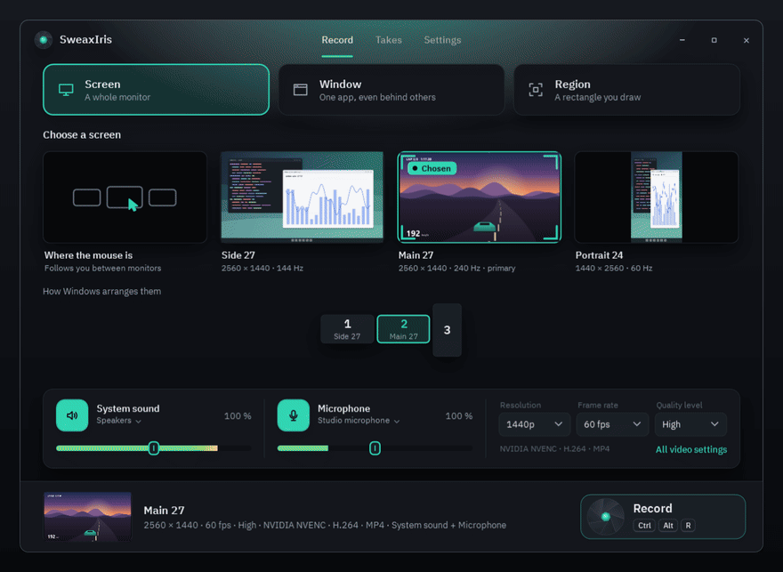
  </picture>
</p>

**SweaxIris** records your screen on Windows 10 and 11: a whole monitor, one window (even behind others) or a
rectangle you draw. System sound and your microphone come along, each with its own switch and volume, and a
pause carries on in **the same file**. The picture goes straight from Windows' own capture into your graphics
card's video engine (NVIDIA NVENC, AMD AMF or Intel Quick Sync, with x264 on the processor as a fallback), so a
1440p game at 144 fps is recorded without dropping frames.

Every action has a shortcut you choose, and the shortcuts take the macro keys of gaming keyboards: a key
programmed to send `Pause`, `Scroll Lock` or `F13`–`F24` works on its own, no modifier needed.

The name is the idea: the record button is a camera iris. It opens when you record, stops down with each second
of the countdown, half closes when you pause and shuts when the take is saved.

> **New in 1.1 — the studio, rebuilt.** Everything you can record is on screen as a live picture: click a
> monitor, a window or a region and that is what records. Faders that are also level meters, a record strip that
> always says exactly what will happen, a large program picture while recording, Takes and Settings as pages of
> their own, and a region picker with frame shapes, exact sizes, snapping and a pixel loupe.

---

## Contents

- [See it](#see-it) · [The studio](#the-studio) · [The region picker](#the-region-picker) · [Features](#features) · [Settings](#settings) · [Colours](#colours)
- [Shortcuts](#shortcuts) · [Recording options](#recording-options) · [Sound](#sound)
- [Measured](#measured) · [How it works](#how-it-works) · [Install](#install) · [Command line](#command-line)
- [Where things are](#where-things-are) · [Privacy](#privacy) · [FAQ](#faq) · [Build from source](#build-from-source) · [License](#license)

---

## See it

Three steps, in the order the window asks them: **what** to record, **with which sound**, then the iris.

<table>
<tr>
<td width="33%" valign="top"><picture><source media="(prefers-color-scheme: light)" srcset="docs/media/main-en-light.png">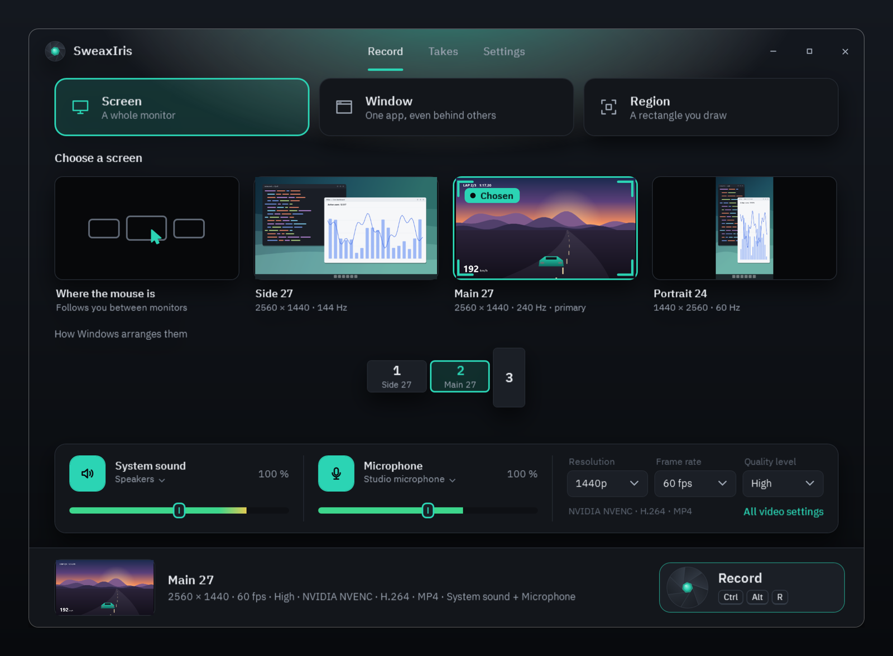</picture><br><sub><b>Screen</b> — every monitor live, or the one under the mouse; a map shows how they sit.</sub></td>
<td width="33%" valign="top"><picture><source media="(prefers-color-scheme: light)" srcset="docs/media/main-window-en-light.png">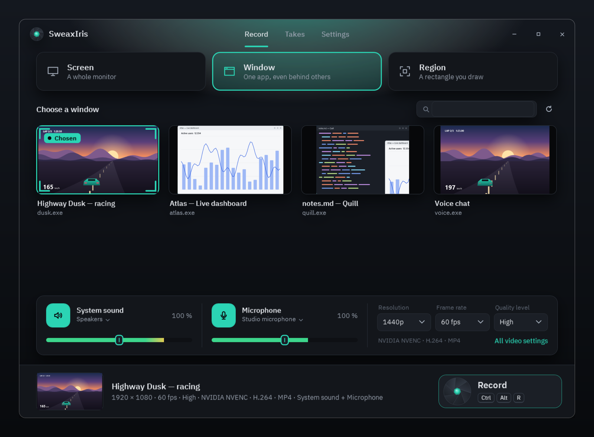</picture><br><sub><b>Window</b> — every open window live, even ones behind others; search by title or app.</sub></td>
<td width="33%" valign="top"><picture><source media="(prefers-color-scheme: light)" srcset="docs/media/main-region-en-light.png">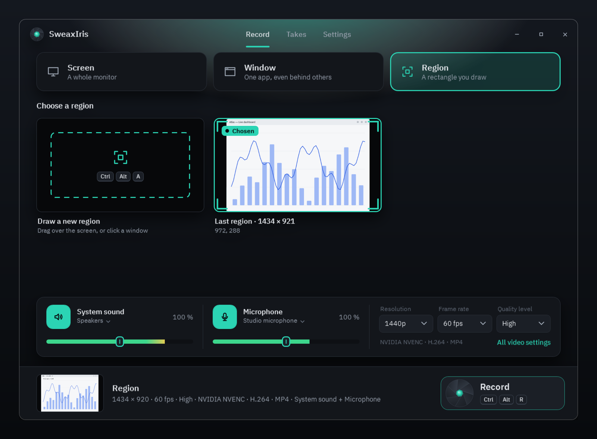</picture><br><sub><b>Region</b> — draw a new one, or keep recording the last one.</sub></td>
</tr>
</table>

<p align="center">
  <picture>
    <source media="(prefers-color-scheme: light)" srcset="docs/media/region-en-light.gif">
    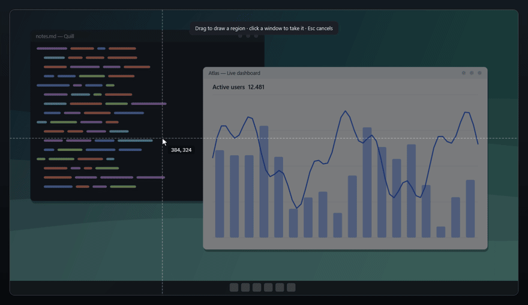
  </picture>
</p>

The same films as video: [studio, dark](docs/media/record-en-dark.mp4) ·
[studio, light](docs/media/record-en-light.mp4) · [region, dark](docs/media/region-en-dark.mp4) ·
[region, light](docs/media/region-en-light.mp4)

> Every picture in this README is drawn by SweaxIris itself in its `--shots` mode: the real windows, stepped
> frame by frame, with a made-up game and a made-up desktop. Nobody's real screen appears.

---

## The studio

<p align="center">
  <picture>
    <source media="(prefers-color-scheme: light)" srcset="docs/media/main-en-light.png">
    
  </picture>
</p>

- **What.** Screen, Window or Region, then a live picture of everything that fits. Pictures refresh a few times a
  second, the chosen one faster; hover lifts a tile and brings in viewfinder corners, choosing one pulls focus.
  With more than one monitor a to-scale map below shows how Windows arranges them, portrait screens included.
- **Sound.** One fader each for system sound and microphone. The fader *is* the meter: the bar shows how loud the
  source is after the volume, the knob sets the volume (0–200 %, a soft click at 100 %; the mouse wheel works too).
  The device is one click away under the name; the big button switches the source on or off.
- **Picture.** Resolution, frame rate and quality at hand, the encoder in use underneath, everything else one click
  away in Settings.
- **The record strip.** Always says what will happen: the chosen picture, its size after scaling, frame rate,
  quality, encoder and sound — and the iris with its shortcut.

While recording, the picker gives way to the **program picture**: what is being recorded, large, with `REC` and
the time. Timecode, pause and mic spring out on the strip; the iris opens wide in tally red.

<p align="center">
  <picture>
    <source media="(prefers-color-scheme: light)" srcset="docs/media/main-recording-en-light.png">
    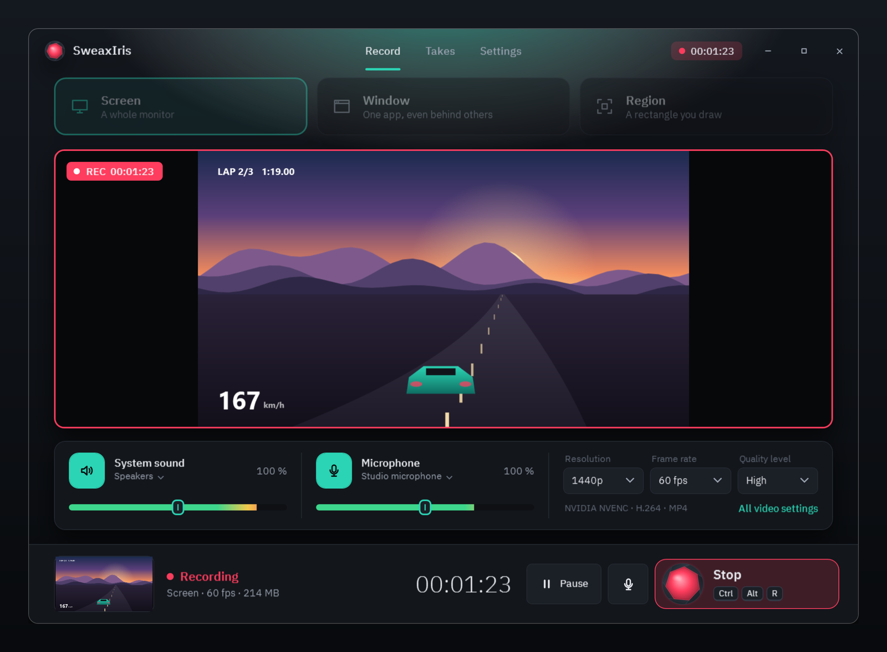
  </picture>
</p>

**Takes** is a page of its own: every recording as a card with its picture, length, size and frame rate. Click to
play; hover for *show in folder* and *move to the Recycle Bin*; right-click to copy the file.

<p align="center">
  <picture>
    <source media="(prefers-color-scheme: light)" srcset="docs/media/library-en-light.png">
    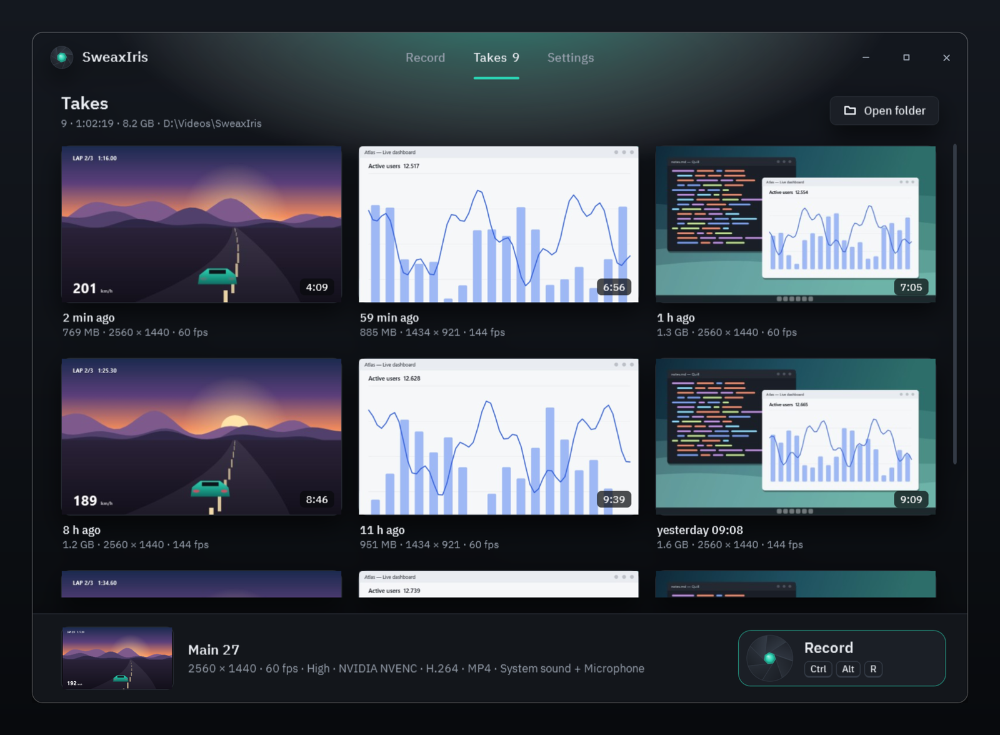
  </picture>
</p>

**The recording bar** sits beside what you record: a breathing tally light, the time, the two sound levels, and
pause, mic and stop. Drag it anywhere.

<p align="center">
  <picture>
    <source media="(prefers-color-scheme: light)" srcset="docs/media/bar-en-light.png">
    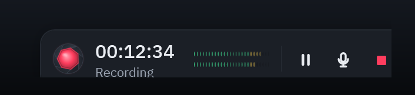
  </picture>
</p>

---

## The region picker

Press <kbd>Ctrl</kbd> <kbd>Alt</kbd> <kbd>A</kbd> (or choose **Region → Draw a new region**). Every monitor dims and a
dock drops in at the top.

<table>
<tr>
<td width="50%" valign="top"><picture><source media="(prefers-color-scheme: light)" srcset="docs/media/select-hover-en-light.png">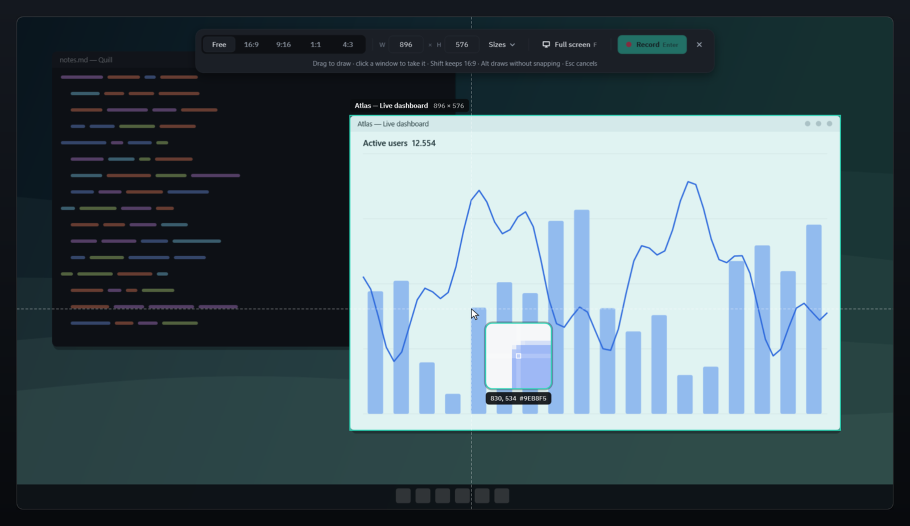</picture><br><sub><b>Choosing</b> — the frame glides onto the window under the pointer; the loupe shows the exact pixel.</sub></td>
<td width="50%" valign="top"><picture><source media="(prefers-color-scheme: light)" srcset="docs/media/select-en-light.png">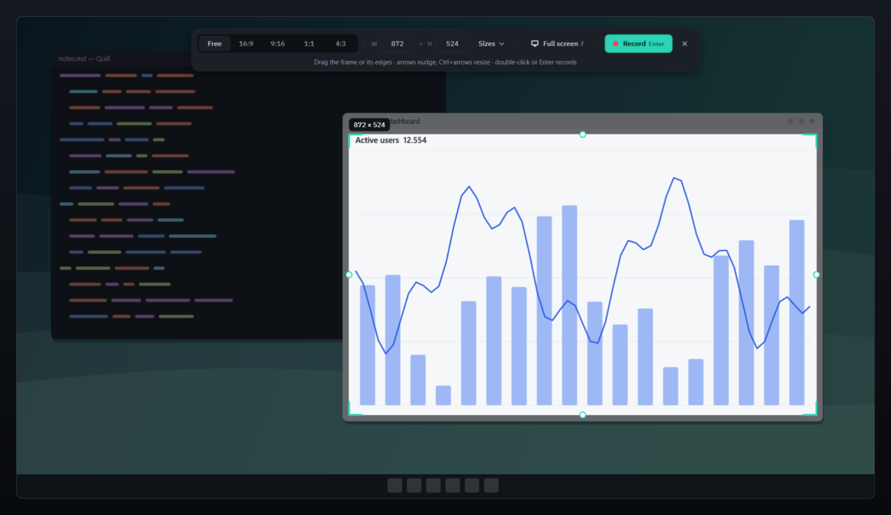</picture><br><sub><b>Adjusting</b> — pull the edges or type the size; <kbd>Enter</kbd> records.</sub></td>
</tr>
</table>

- **Click a window** to take its frame, or **drag** anywhere to draw.
- **Snapping.** Edges snap to window and screen edges, with a guide line; hold <kbd>Alt</kbd> to draw freely.
- **Frame shapes.** Free, 16:9, 9:16 (for Shorts, Reels and TikTok), 1:1 and 4:3. Drawing and resizing keep the
  shape; <kbd>Shift</kbd> keeps 16:9 when the shape is free.
- **Exact size.** Type the width and height in pixels, or pick 4K, 1440p, 1080p, 720p, 1080 × 1920, 1080 × 1350 or
  1080 × 1080 from **Sizes**. **Full screen** (or <kbd>F</kbd>) takes the whole monitor.
- **Loupe.** While choosing and resizing, the pixels under the pointer are shown eight times larger with their
  position and colour, so an edge lands exactly where you want it.
- **Keys.** Arrows nudge (with <kbd>Shift</kbd> ten pixels), <kbd>Ctrl</kbd> + arrows resize, <kbd>Enter</kbd> or a
  double-click records, <kbd>Esc</kbd> or a right-click cancels.

After the countdown only that rectangle is recorded; a thin frame marks it and the recording bar sits just
underneath. Neither appears in the video. SweaxIris remembers the region, so the next time it is one click.

---

## Features

<table>
<tr>
<td width="50%" valign="top">
<picture><source media="(prefers-color-scheme: light)" srcset="docs/art/feature-region-light.svg"></picture>

**A region in two keys.** A picker on every monitor, exact to the pixel on mixed-DPI setups, with frame shapes,
exact sizes, snapping and a loupe. SweaxIris remembers the last region, so the next time <kbd>Enter</kbd> is all
it takes.
</td>
<td width="50%" valign="top">
<picture><source media="(prefers-color-scheme: light)" srcset="docs/art/feature-pause-light.svg"></picture>

**Pause into the same file.** Pausing stops the recording's own clock. Picture and sound both follow that clock,
so after any number of pauses the file plays straight through, in sync, with nothing to join afterwards.
</td>
</tr>
<tr>
<td valign="top">
<picture><source media="(prefers-color-scheme: light)" srcset="docs/art/feature-encoders-light.svg"></picture>

**The graphics card does the work.** NVENC and AMF read the captured frames straight from video memory (no copy
back to the processor). H.264, HEVC and AV1 where the card has them; x264 when there is no hardware encoder.
Automatic picks the engine of the card that drives the monitor.
</td>
<td valign="top">
<picture><source media="(prefers-color-scheme: light)" srcset="docs/art/feature-audio-light.svg"></picture>

**Sound you control.** System sound and microphone, each with on/off, a fader that is also its meter, and a
device. Mute the mic with a key while recording, keep each source on its own track for editing, or record just
one app's sound when recording its window.
</td>
</tr>
<tr>
<td valign="top">
<picture><source media="(prefers-color-scheme: light)" srcset="docs/art/feature-macro-light.svg"></picture>

**Macro keys welcome.** Every shortcut is recorded by pressing it, and keys from keyboard macro software count.
Teach a G key to press <kbd>Pause</kbd> and it starts and stops recording from inside a game.
</td>
<td valign="top">
<picture><source media="(prefers-color-scheme: light)" srcset="docs/art/feature-hidden-light.svg"></picture>

**Never in its own video.** The studio window, the recording bar, the region picker, its frame and the countdown
are kept out of every capture by Windows itself, so you can leave them on screen while you record.
</td>
</tr>
</table>

---

## Settings

Everything is adjustable, every shortcut included. Settings is a page of the studio; <kbd>Esc</kbd> goes back to
Record, and **All video settings** under the picture controls opens the Video page directly.

<table>
<tr>
<td width="50%"><picture><source media="(prefers-color-scheme: light)" srcset="docs/media/settings-keys-en-light.png">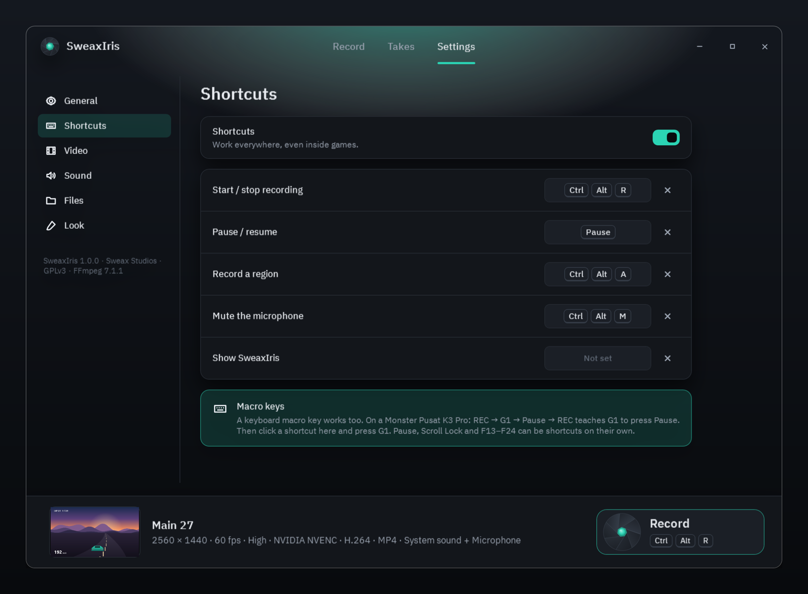</picture><br><sub><b>Shortcuts</b> — click one and press the keys.</sub></td>
<td width="50%"><picture><source media="(prefers-color-scheme: light)" srcset="docs/media/settings-video-en-light.png">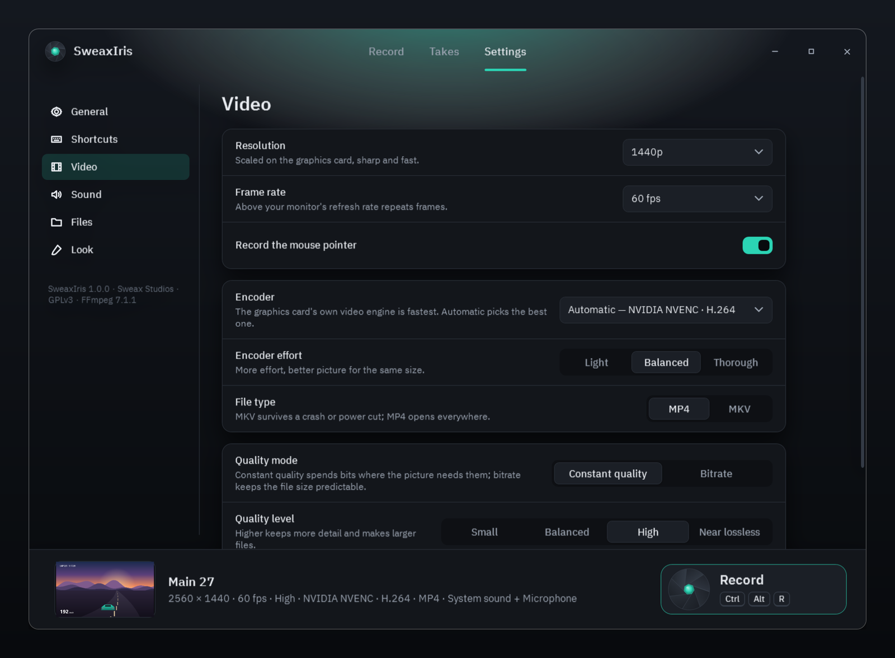</picture><br><sub><b>Video</b> — resolution, frame rate, encoder, quality mode and level or bitrate, effort, keyframes, MP4 or MKV.</sub></td>
</tr>
<tr>
<td><picture><source media="(prefers-color-scheme: light)" srcset="docs/media/settings-sound-en-light.png">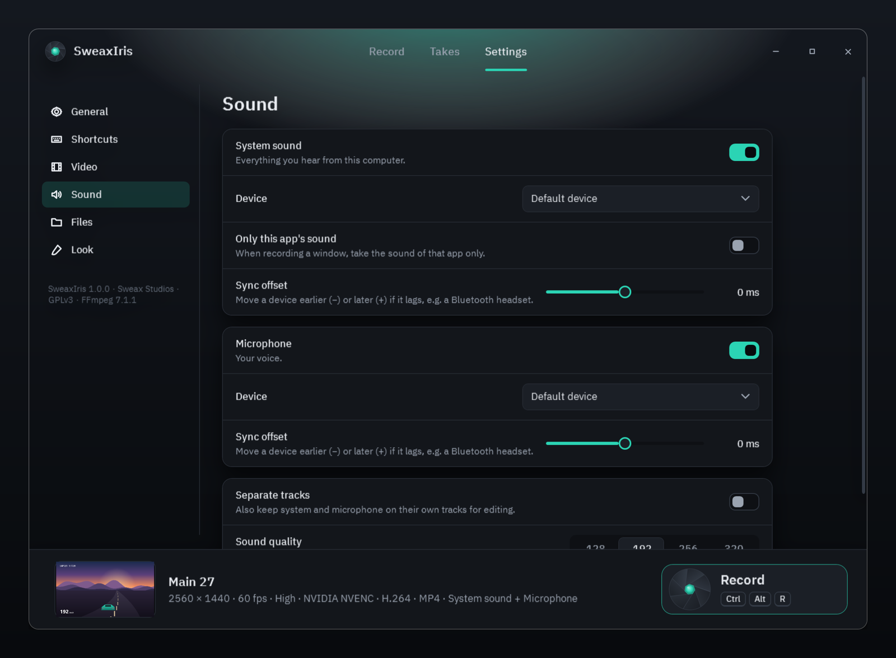</picture><br><sub><b>Sound</b> — devices, app-only sound, sync offsets, separate tracks, AAC quality.</sub></td>
<td><picture><source media="(prefers-color-scheme: light)" srcset="docs/media/settings-general-en-light.png">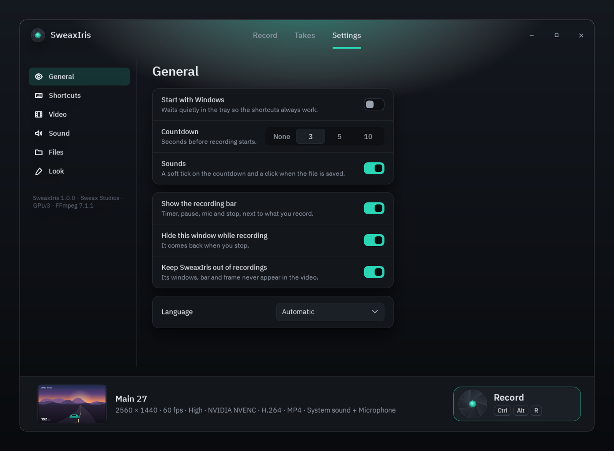</picture><br><sub><b>General</b> — start with Windows, countdown, recording bar, hide while recording, keep out of recordings.</sub></td>
</tr>
</table>

---

## Colours

Light, dark or like Windows, and six lens coatings for the accent. Recording is always tally red.

<p align="center">
  <picture>
    <source media="(prefers-color-scheme: light)" srcset="docs/media/palettes-en-light.png">
    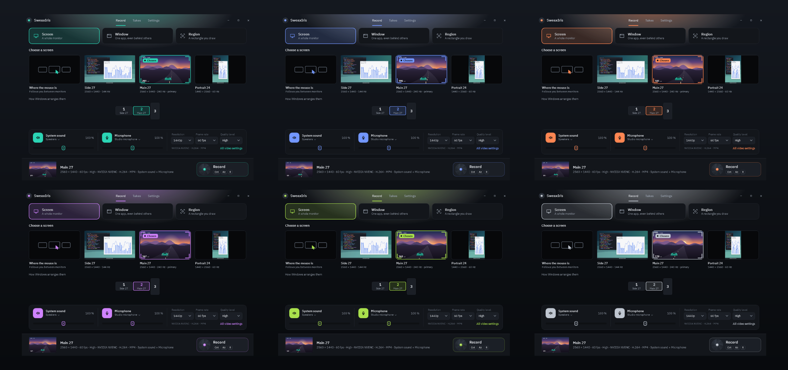
  </picture>
</p>

---

## Shortcuts

| Action | Default | Notes |
|---|---|---|
| Start / stop recording | <kbd>Ctrl</kbd> <kbd>Alt</kbd> <kbd>R</kbd> | During the countdown it cancels. |
| Pause / resume | <kbd>Ctrl</kbd> <kbd>Alt</kbd> <kbd>P</kbd> | Same file, same clock. |
| Record a region | <kbd>Ctrl</kbd> <kbd>Alt</kbd> <kbd>A</kbd> | Opens the picker, then records what you draw. |
| Mute the microphone | <kbd>Ctrl</kbd> <kbd>Alt</kbd> <kbd>M</kbd> | A short ramp, no click. |
| Show SweaxIris | not set | |

All five are changed in **Settings → Shortcuts** by clicking one and pressing the keys. The shortcuts work
everywhere, inside games too, and are swallowed so the game does not see them.

**Macro keys (for example the G1–G5 keys of a Monster Pusat K3 Pro).** Out of the box those keys send `F1`–`F5`,
which games use, so give one a key nobody types with: on the K3 Pro press `REC`, then `G1`, then `Pause`, then `REC`
again. Now click a shortcut in Settings and press `G1`. `Pause`, `Scroll Lock` and `F13`–`F24` may be shortcuts on
their own; letters and digits need <kbd>Ctrl</kbd> or <kbd>Alt</kbd> so they never get in the way of typing.

Launchers that run programs instead of pressing keys can use the [command line](#command-line).

---

## Recording options

| Option | Choices | Default |
|---|---|---|
| What | a monitor (or the one under the mouse), a window, a region | the monitor under the mouse |
| Resolution | as captured, 2160p, 1440p, 1080p, 720p, 480p (scaled on the graphics card) | as captured |
| Frame rate | 24, 30, 48, 50, 60, 90, 120, 144, 165, 240 | 60 |
| Encoder | Automatic, or any of NVENC / AMF / Quick Sync × H.264 / HEVC / AV1 this PC can run, x264 | Automatic |
| Quality | constant quality (Small, Balanced, High, Near lossless) or a bitrate (2–150 Mb/s) | High |
| Encoder effort | Light, Balanced, Thorough | Balanced |
| Keyframe every | 1, 2, 3, 5, 10 s | 2 s |
| File | MP4 (opens everywhere) or MKV (survives a crash) | MP4 |
| Mouse pointer | on / off | on |
| Countdown | none, 3, 5, 10 s | 3 s |

SweaxIris checks which encoders this computer really runs when it starts (it opens each one for a moment) and only
offers those. Colour is BT.709 in TV range, written into the file, so players show the colours you saw.

## Sound

| | System sound | Microphone |
|---|---|---|
| Switch and volume (0–200 %) | ✓ | ✓ |
| Device | default (follows Windows when it changes) or a chosen one | default or a chosen one |
| Live meter | ✓ | ✓ |
| Mute on a key | | ✓ |
| Sync offset (−500…+500 ms) | ✓ | ✓, for Bluetooth headsets |
| Only one app's sound | when recording a window | |

Both are mixed into one AAC track (48 kHz, 128–320 kb/s). **Separate tracks** also keeps each source on a track
of its own, for editing. A device that is unplugged during a recording is picked up again when it returns.

---

## Measured

SweaxIris has a self-test that records only what it draws itself (a GPU test pattern that stamps every frame with
its time in milliseconds, a test tone, and its own test window), then reads the files back with
`tools/analyze.py`: every frame's stamp, every flash against every tone.

Graphics card RTX 4070 SUPER, processor Ryzen 5 7600 with its AMD Radeon graphics for AMF, Windows 11 25H2:

| Encoder | Size · fps | Frames lost | Sound vs picture |
|---|---|---|---|
| NVENC H.264 | 1920×1080 · 60 | 0 | −0.1 ms |
| NVENC H.264 | 2560×1440 · 144 | 0 | −0.2 ms |
| NVENC HEVC | 3840×2160 · 60 | 0 | −0.1 ms |
| NVENC AV1 | 2560×1440 · 120 | 0 | −0.1 ms |
| AMF H.264 (integrated graphics) | 1920×1080 · 60 | 0 | −0.2 ms |
| AMF HEVC (integrated graphics) | 2560×1440 · 60 | 0 | −0.1 ms |
| x264 (processor) | 1920×1080 · 60 | 0 | −0.1 ms |

- **Every frame on time.** Each frame shows the moment its timestamp stands for (measured: under 1 ms off) and none
  is dropped or repeated in any of the runs above.
- **Pauses.** Flash and tone stay within one frame of each other before and after each pause, in MP4 and MKV.
- **Clock drift.** A sound card running 0.08 % fast or slow is stretched back onto the system clock; after 20 s
  with two pauses the drift test still lines up.
- **Real capture.** Recording SweaxIris's own test window through Windows.Graphics.Capture, with its own sound
  through app-only loopback: sound lands about 21 ms after the picture, a constant, inside broadcast tolerance.
- **Under load.** The same matrix run while three Blender renders kept the processor at 100 %: the NVENC HEVC 4K60
  and AV1 1440p120 runs still lost nothing; the processor-bound x264 run did, as expected. SweaxIris raises its
  own priority while recording.

Run it yourself: `SweaxIris.exe --selftest <folder>` then `python tools/analyze.py <folder>`.

---

## How it works

<p align="center">
  <picture>
    <source media="(prefers-color-scheme: light)" srcset="docs/art/architecture-light.svg">
    
  </picture>
</p>

- **Capture.** Windows.Graphics.Capture hands over every refresh of the monitor or window together with the moment
  Windows composed it. SweaxIris keeps the last few in a ring on the graphics card.
- **Clock.** A high-resolution timer ticks at the chosen frame rate, a little behind real time. Each tick takes the
  frame composed at its moment, so frames are evenly spaced even when a game is not.
- **Picture.** The GPU's video engine scales the frame and turns it into NV12 (BT.709). For NVENC and AMF the
  result is copied into the encoder's own surface pool; nothing visits main memory.
- **Sound.** WASAPI streams (speakers in loopback, the microphone, or one app) arrive with their capture times. The
  mixer places each packet on the timeline, fills gaps with silence, smooths sound-card drift with gentle
  resampling, ramps volume changes and sums the tracks.
- **Timeline.** One clock for both: it stops while paused and is the only thing that decides where a frame or a
  sample goes. That is why pausing needs no second file.
- **File.** FFmpeg 7.1 writes MP4 (with `hvc1` tags for Apple players) or MKV.

Code map: `Capture/` (WGC, GPU, conversion, preview, live tile pictures), `Encode/` (FFmpeg encoders and muxer), `Audio/` (WASAPI,
mixer), `Recording/` (timeline, recorder, studio), `UI/` (windows, iris, controls, springs), `Dev/` (self-test,
pictures).

---

## Install

1. Download **SweaxIris-1.1.0-Setup.exe** from [Releases](https://github.com/Sweax3169/sweaxiris/releases/latest).
2. Run it. It installs for your user only (no administrator), into `%LOCALAPPDATA%\Programs\SweaxIris`, and can
   start with Windows so the shortcuts always work.

Prefer no installer? The zip next to it runs from any folder. `SHA256SUMS.txt` lists the checksums of both.

**Needs** Windows 10 2004 or newer and a DirectX 11 graphics card. Windows 11 removes the yellow capture border;
Windows 11 24H2 or newer is needed to capture faster than 60 fps. Hardware encoders need a recent driver.

Windows SmartScreen may warn the first time because the program is not code-signed: **More info → Run anyway**.

## Command line

```text
SweaxIris.exe               open the studio
SweaxIris.exe --background  start in the tray (used by "Start with Windows")
SweaxIris.exe --record      start, or stop, recording
SweaxIris.exe --stop        stop recording
SweaxIris.exe --pause       pause or resume
SweaxIris.exe --region      draw a region and record it
SweaxIris.exe --mic         mute or unmute the microphone
SweaxIris.exe --quit        stop recording if needed and quit
SweaxIris.exe --selftest D  record test patterns into folder D (see Measured)
```

A second launch passes the command to the running SweaxIris and exits.

## Where things are

```text
%APPDATA%\SweaxIris\
  settings.json      every setting
  takes.json         the takes list
  thumbs\            one small picture per take
  sweaxiris.log      what happened, for bug reports
Videos\SweaxIris\    recordings (change it in Settings → Files)
```

## Privacy

SweaxIris works offline. It sends nothing anywhere, has no account and no telemetry. It records only when you
start it, and only what you chose. Microphone and system sound are opened for the meters only while the studio
window is open, and for the recording. The live pictures of your monitors and windows run only while the Record
page is on screen, stay inside the app, and stop while recording.

## FAQ

**A game shows black.** Games in true exclusive fullscreen are not composed by Windows; switch the game to
borderless or fullscreen-optimised mode (the default for most DirectX 11/12 games).

**Shortcuts do nothing in one program.** That program runs as administrator; Windows does not pass its keys to
normal programs. Run SweaxIris as administrator too, or use the command line from a launcher.

**Can a region span two monitors?** No: it stays on the monitor where you start drawing.

**HDR?** HDR screens are recorded as SDR, the way Windows maps them for capture.

**Why would I choose MKV?** A power cut or crash leaves an MKV playable up to that moment; an unfinished MP4 is not.

**My Bluetooth headset sound is late.** Give the device a negative sync offset in Settings → Sound.

## Build from source

```powershell
./tools/fetch-ffmpeg.ps1                 # FFmpeg 7.1.1 shared libraries, checked by SHA-256
dotnet build src/SweaxIris -c Release
dotnet publish src/SweaxIris -c Release -r win-x64 --self-contained true -p:PublishSingleFile=true -o out/app
out/app/SweaxIris.exe --selftest out/test ; python tools/analyze.py out/test
```

Pictures: `SweaxIris.exe --shots docs/shots --theme dark --lang en`, then `python tools/encode-media.py docs/shots docs/media`
and `python tools/art.py docs/art`. Releases are built by GitHub Actions (`.github/workflows/build.yml`) with Inno Setup.

## License

GPL v3 — see [LICENSE](LICENSE). SweaxIris uses FFmpeg 7.1.1 (GPL v3 build by gyan.dev), FFmpeg.AutoGen,
Vortice.Windows and the IBM Plex Sans typeface; see [THIRD_PARTY_NOTICES.md](THIRD_PARTY_NOTICES.md).

Made by **Sweax Studios** · [github.com/Sweax3169](https://github.com/Sweax3169)
