<p align="center">
  <picture>
    <source media="(prefers-color-scheme: light)" srcset="docs/art/banner-tr-light.svg">
    
  </picture>
</p>

<p align="center">
  <a href="https://github.com/Sweax3169/sweaxiris/releases/latest"><b>Windows için indir</b></a> ·
  <a href="https://sweax3169.github.io/sweaxiris/">Web sitesi</a> ·
  <a href="README.md">English</a> ·
  <a href="#kurulum">Kurulum</a> ·
  <a href="#kısayollar">Kısayollar</a> ·
  <a href="#ölçümler">Ölçümler</a>
</p>

<p align="center">
  <picture>
    <source media="(prefers-color-scheme: light)" srcset="docs/media/record-tr-light.gif">
    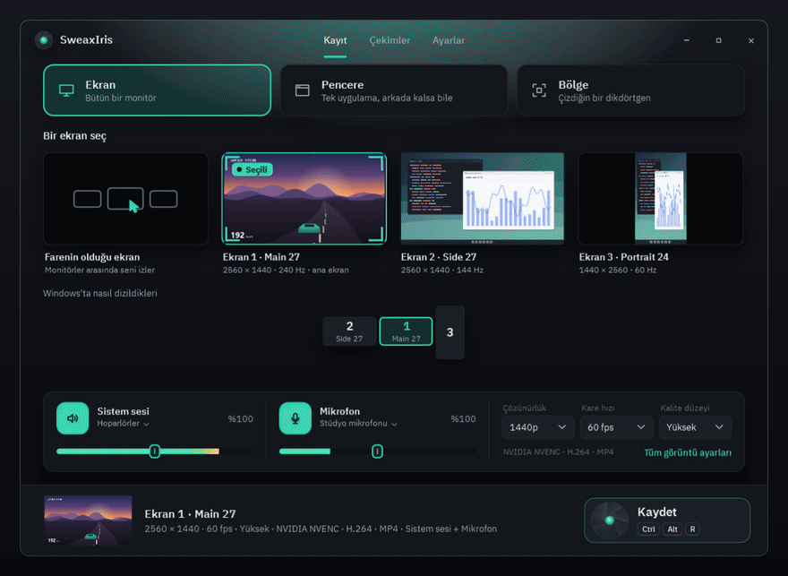
  </picture>
</p>

**SweaxIris**, Windows 10 ve 11'de ekranını kaydeder: bütün bir monitörü, tek bir pencereyi (başka pencerelerin
arkasında kalsa bile) ya da çizdiğin bir dikdörtgeni. Sistem sesi ve mikrofonun da gelir; ikisinin de kendi
anahtarı ve ses düzeyi var. Duraklatınca kayıt **aynı dosyada** devam eder. Görüntü, Windows'un kendi
yakalamasından doğrudan ekran kartının video motoruna gider (NVIDIA NVENC, AMD AMF ya da Intel Quick Sync; donanım
yoksa işlemcide x264). Böylece 1440p 144 fps bir oyun kare kaçırmadan kaydedilir.

Her işin, senin seçtiğin bir kısayolu var ve kısayollar oyuncu klavyelerinin makro tuşlarını kabul eder: `Pause`,
`Scroll Lock` ya da `F13`–`F24` gönderen bir tuş, yanına Ctrl/Alt gerekmeden tek başına çalışır.

İsim fikrin kendisi: kayıt düğmesi bir kamera diyaframı. Kayıtta açılır, geri sayımın her saniyesinde kısılır,
duraklatınca yarıya kapanır, çekim kaydedilince kapanır.

> **1.1'de yeni — stüdyo baştan yapıldı.** Kaydedebileceğin her şey ekranda canlı bir görüntü olarak durur:
> monitöre, pencereye ya da bölgeye tıkla, kaydedilecek olan odur. Aynı zamanda ses ölçeri olan sürgüler, ne
> olacağını her an söyleyen bir kayıt şeridi, kayıtta büyük bir yayın görüntüsü, kendi sayfaları olan Çekimler ve
> Ayarlar; çerçeve oranları, piksel olarak boyut, kenara yapışma ve büyüteçli bir bölge seçici.

---

## İçindekiler

- [İzle](#izle) · [Stüdyo](#stüdyo) · [Bölge seçici](#bölge-seçici) · [Özellikler](#özellikler) · [Ayarlar](#ayarlar) · [Renkler](#renkler)
- [Kısayollar](#kısayollar) · [Kayıt seçenekleri](#kayıt-seçenekleri) · [Ses](#ses)
- [Ölçümler](#ölçümler) · [Nasıl çalışır](#nasıl-çalışır) · [Kurulum](#kurulum) · [Komut satırı](#komut-satırı)
- [Dosyalar nerede](#dosyalar-nerede) · [Gizlilik](#gizlilik) · [SSS](#sss) · [Kaynaktan derleme](#kaynaktan-derleme) · [Lisans](#lisans)

---

## İzle

Pencerenin sorduğu sırayla üç adım: **ne** kaydedilecek, **hangi sesle**, sonra diyafram.

<table>
<tr>
<td width="33%" valign="top"><picture><source media="(prefers-color-scheme: light)" srcset="docs/media/main-tr-light.png">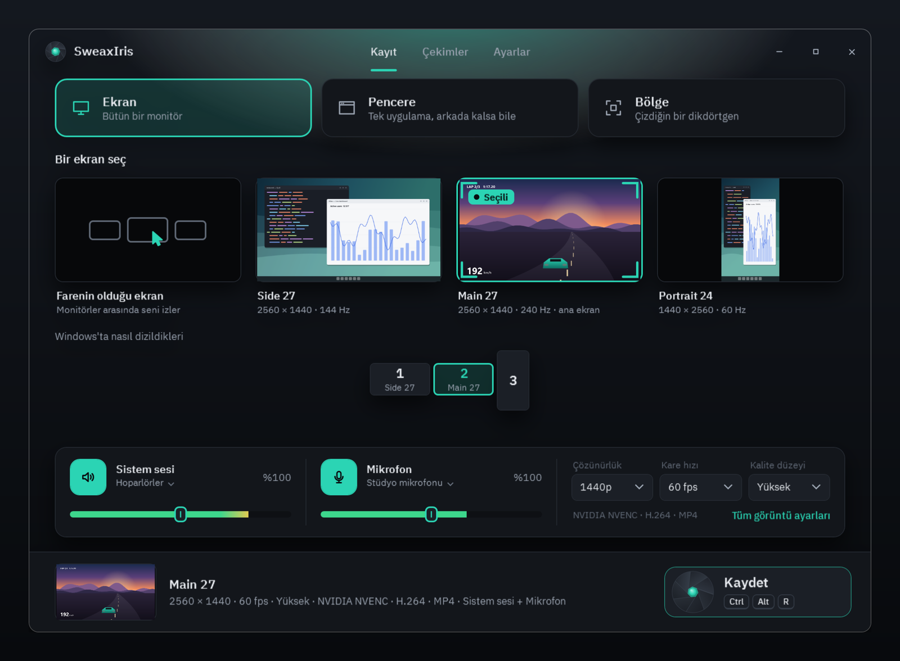</picture><br><sub><b>Ekran</b> — her monitör canlı, ya da farenin olduğu; harita nasıl dizildiklerini gösterir.</sub></td>
<td width="33%" valign="top"><picture><source media="(prefers-color-scheme: light)" srcset="docs/media/main-window-tr-light.png">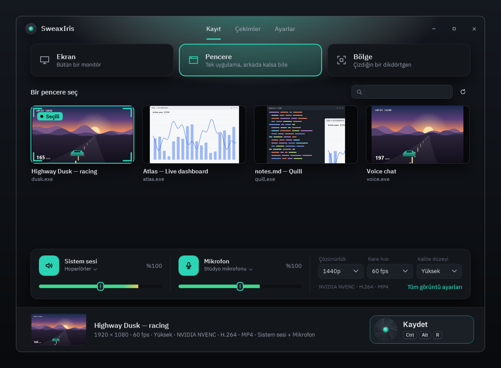</picture><br><sub><b>Pencere</b> — açık her pencere canlı, arkada kalanlar bile; başlığa ya da uygulamaya göre ara.</sub></td>
<td width="33%" valign="top"><picture><source media="(prefers-color-scheme: light)" srcset="docs/media/main-region-tr-light.png">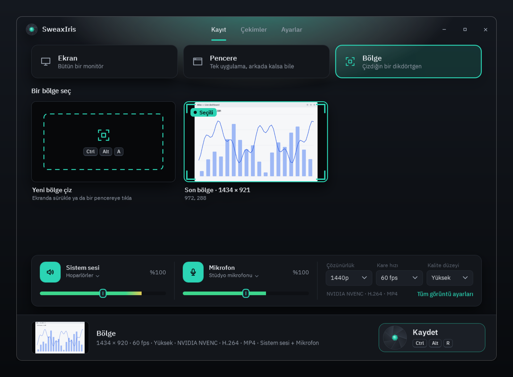</picture><br><sub><b>Bölge</b> — yenisini çiz ya da son bölgeyi kaydetmeyi sürdür.</sub></td>
</tr>
</table>

<p align="center">
  <picture>
    <source media="(prefers-color-scheme: light)" srcset="docs/media/region-tr-light.gif">
    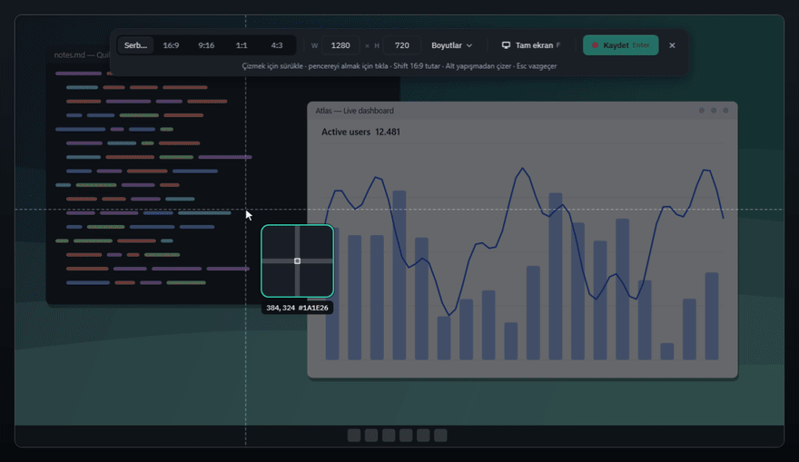
  </picture>
</p>

Aynı filmler video olarak: [stüdyo, koyu](docs/media/record-tr-dark.mp4) ·
[stüdyo, açık](docs/media/record-tr-light.mp4) · [bölge, koyu](docs/media/region-tr-dark.mp4) ·
[bölge, açık](docs/media/region-tr-light.mp4)

> Bu sayfadaki her görseli SweaxIris kendi `--shots` kipinde çizer: gerçek pencereler, kare kare ilerletilerek,
> uydurma bir oyun ve uydurma bir masaüstüyle. Kimsenin gerçek ekranı görünmez.

---

## Stüdyo

<p align="center">
  <picture>
    <source media="(prefers-color-scheme: light)" srcset="docs/media/main-tr-light.png">
    
  </picture>
</p>

- **Ne.** Ekran, Pencere ya da Bölge; ardından uyan her şeyin canlı görüntüsü. Görüntüler saniyede birkaç kez,
  seçili olan daha sık tazelenir; üstüne gelince kart kalkar ve vizör köşeleri belirir, seçince netlik oturur.
  Birden çok monitörde altta ölçekli bir harita, dikey ekranlar dahil Windows'un onları nasıl dizdiğini gösterir.
- **Ses.** Sistem sesi ve mikrofon için birer sürgü. Sürgü aynı zamanda ölçerdir: çubuk kaynağın ses düzeyinden
  sonraki gürlüğünü gösterir, topuz ses düzeyini ayarlar (%0–200, %100'de yumuşak bir tık; fare tekerleği de
  çalışır). Aygıt adın altında bir tık uzakta; büyük düğme kaynağı açar ya da kapatır.
- **Görüntü.** Çözünürlük, kare hızı ve kalite elinin altında, kullanılan kodlayıcı hemen altında, gerisi Ayarlar'da
  bir tık ötede.
- **Kayıt şeridi.** Ne olacağını hep söyler: seçilen görüntü, ölçeklenmiş boyutu, kare hızı, kalite, kodlayıcı ve
  ses — ve kısayoluyla diyafram.

Kayıtta seçici yerini **yayın görüntüsüne** bırakır: kaydedilen şey, büyük, `REC` ve süreyle. Şeritte zaman kodu,
duraklat ve mikrofon yaylanarak çıkar; diyafram kırmızıya geniş açılır.

<p align="center">
  <picture>
    <source media="(prefers-color-scheme: light)" srcset="docs/media/main-recording-tr-light.png">
    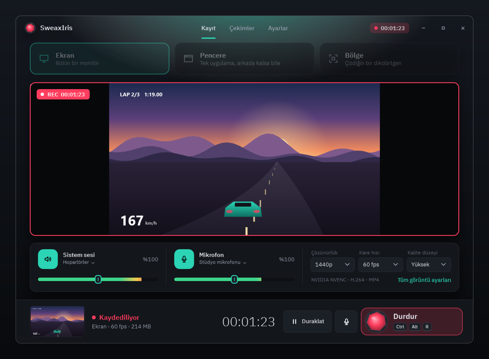
  </picture>
</p>

**Çekimler** kendi sayfası: her kayıt; görüntüsü, süresi, boyutu ve kare hızıyla bir kart. Tıkla oynat; üstüne gel,
*klasörde göster* ve *Geri Dönüşüm Kutusu'na taşı*; sağ tıkla dosyayı kopyala.

<p align="center">
  <picture>
    <source media="(prefers-color-scheme: light)" srcset="docs/media/library-tr-light.png">
    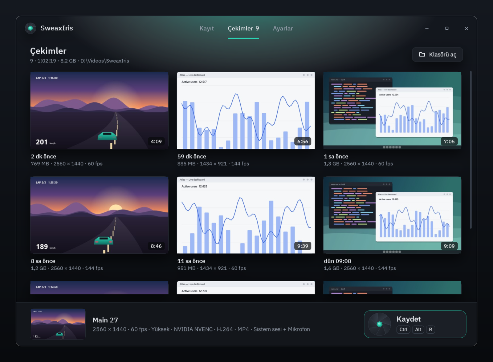
  </picture>
</p>

**Kayıt çubuğu** kaydettiğin yerin yanında durur: nefes alan kayıt ışığı, süre, iki ses düzeyi; duraklat,
mikrofon ve durdur. İstediğin yere sürükle.

<p align="center">
  <picture>
    <source media="(prefers-color-scheme: light)" srcset="docs/media/bar-tr-light.png">
    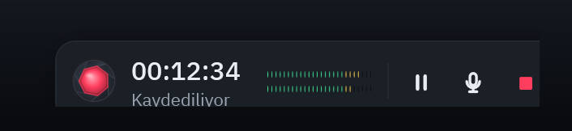
  </picture>
</p>

---

## Bölge seçici

<kbd>Ctrl</kbd> <kbd>Alt</kbd> <kbd>A</kbd>'ya bas (ya da **Bölge → Yeni bölge çiz**). Her monitör kararır, üstte bir
panel iner.

<table>
<tr>
<td width="50%" valign="top"><picture><source media="(prefers-color-scheme: light)" srcset="docs/media/select-hover-tr-light.png">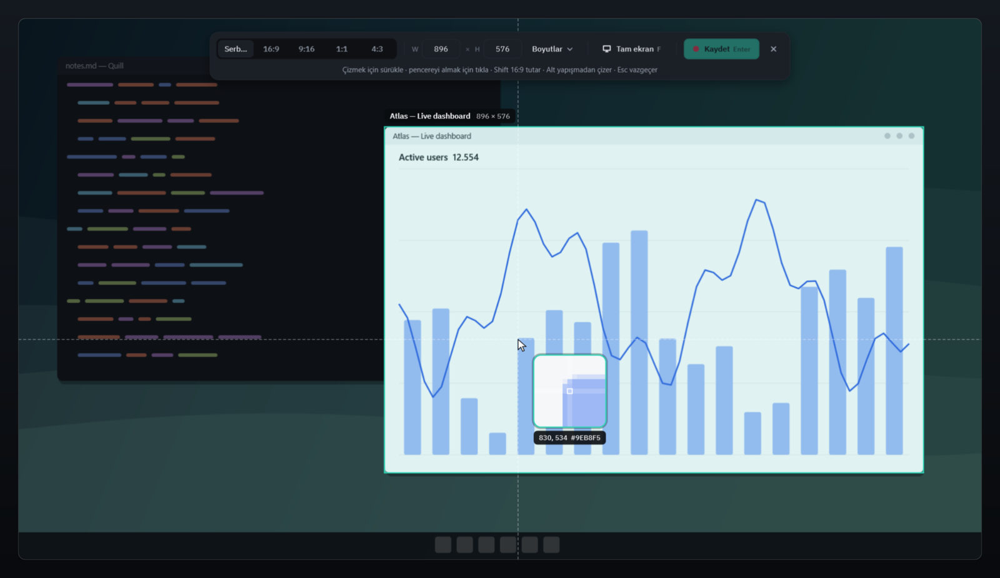</picture><br><sub><b>Seçerken</b> — çerçeve imlecin altındaki pencerenin üstüne kayar; büyüteç tam pikseli gösterir.</sub></td>
<td width="50%" valign="top"><picture><source media="(prefers-color-scheme: light)" srcset="docs/media/select-tr-light.png">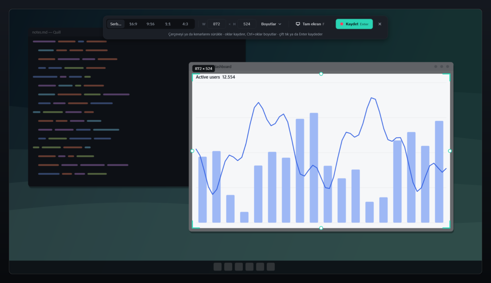</picture><br><sub><b>Ayarlarken</b> — kenarları çek ya da boyutu yaz; <kbd>Enter</kbd> kaydeder.</sub></td>
</tr>
</table>

- Çerçevesini almak için **pencereye tıkla** ya da herhangi bir yerde **sürükleyerek çiz**.
- **Yapışma.** Kenarlar pencere ve ekran kenarlarına, bir kılavuz çizgiyle yapışır; serbest çizmek için
  <kbd>Alt</kbd>'a basılı tut.
- **Çerçeve oranı.** Serbest, 16:9, 9:16 (Shorts, Reels ve TikTok için), 1:1 ve 4:3. Çizerken de boyutlarken de
  oran korunur; oran serbestken <kbd>Shift</kbd> 16:9 tutar.
- **Tam boyut.** Genişliği ve yüksekliği piksel olarak yaz ya da **Boyutlar**'dan 4K, 1440p, 1080p, 720p,
  1080 × 1920, 1080 × 1350 veya 1080 × 1080 seç. **Tam ekran** (ya da <kbd>F</kbd>) bütün monitörü alır.
- **Büyüteç.** Seçerken ve boyutlarken imlecin altındaki pikseller sekiz kat büyük, konumu ve rengiyle görünür;
  kenar tam istediğin yere oturur.
- **Tuşlar.** Oklar kaydırır (<kbd>Shift</kbd> ile on piksel), <kbd>Ctrl</kbd> + oklar boyutlar, <kbd>Enter</kbd> ya da
  çift tık kaydeder, <kbd>Esc</kbd> ya da sağ tık vazgeçer.

Geri sayımdan sonra yalnız o dikdörtgen kaydedilir; ince bir çerçeve onu işaretler, kayıt çubuğu hemen altında
durur. İkisi de videoya girmez. Bölge hatırlanır; sonraki sefer tek tık.

---

## Özellikler

<table>
<tr>
<td width="50%" valign="top">
<picture><source media="(prefers-color-scheme: light)" srcset="docs/art/feature-region-light.svg"></picture>

**İki tuşla bölge.** Her monitörde bir seçici; farklı ölçekli ekranlarda bile pikseli pikseline, çerçeve oranları,
tam boyutlar, yapışma ve büyüteçle. Son bölge hatırlanır; sonraki sefer <kbd>Enter</kbd> yeter.
</td>
<td width="50%" valign="top">
<picture><source media="(prefers-color-scheme: light)" srcset="docs/art/feature-pause-light.svg"></picture>

**Aynı dosyada duraklat.** Duraklatmak kaydın kendi saatini durdurur. Görüntü de ses de o saati izler; kaç kez
duraklatırsan duraklat dosya baştan sona senkron oynar, sonradan birleştirecek bir şey kalmaz.
</td>
</tr>
<tr>
<td valign="top">
<picture><source media="(prefers-color-scheme: light)" srcset="docs/art/feature-encoders-light.svg"></picture>

**İşi ekran kartı yapar.** NVENC ve AMF yakalanan kareleri doğrudan video belleğinden okur (işlemciye kopya yok).
Kart destekliyorsa H.264, HEVC ve AV1; donanım kodlayıcı yoksa x264. Otomatik, monitörü süren kartın motorunu seçer.
</td>
<td valign="top">
<picture><source media="(prefers-color-scheme: light)" srcset="docs/art/feature-audio-light.svg"></picture>

**Sesi sen yönet.** Sistem sesi ve mikrofon; her birinde aç/kapa, aynı zamanda ölçer olan bir sürgü ve aygıt
seçimi. Kayıtta mikrofonu bir tuşla sustur, kurgu için kaynakları ayrı kanallarda tut ya da bir pencereyi
kaydederken yalnız o uygulamanın sesini al.
</td>
</tr>
<tr>
<td valign="top">
<picture><source media="(prefers-color-scheme: light)" srcset="docs/art/feature-macro-light.svg"></picture>

**Makro tuşlarına açık.** Her kısayol tuşlara basılarak kaydedilir; klavye makro yazılımından gelen tuşlar da
sayılır. Bir G tuşuna <kbd>Pause</kbd> öğret; oyunun içinden kaydı başlatıp durdursun.
</td>
<td valign="top">
<picture><source media="(prefers-color-scheme: light)" srcset="docs/art/feature-hidden-light.svg"></picture>

**Kendi videosuna girmez.** Stüdyo penceresi, kayıt çubuğu, bölge seçici, çerçevesi ve geri sayım, Windows'un
kendisi tarafından her yakalamanın dışında tutulur; kayıt sırasında ekranda kalabilirler.
</td>
</tr>
</table>

---

## Ayarlar

Her şey ayarlanabilir, her kısayol dahil. Ayarlar stüdyonun bir sayfası; <kbd>Esc</kbd> Kayıt'a döner, görüntü
seçeneklerinin altındaki **Tüm görüntü ayarları** doğrudan Görüntü sayfasını açar.

<table>
<tr>
<td width="50%"><picture><source media="(prefers-color-scheme: light)" srcset="docs/media/settings-keys-tr-light.png">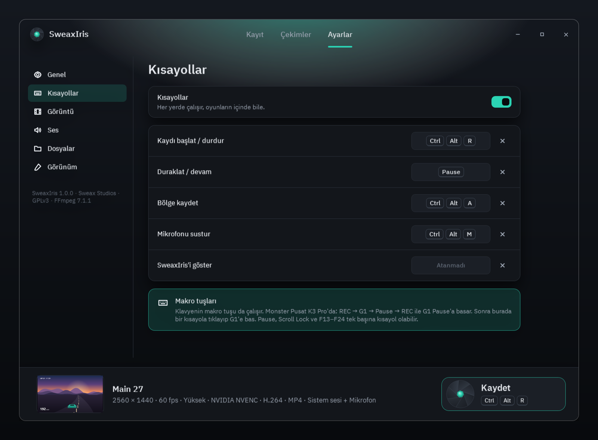</picture><br><sub><b>Kısayollar</b> — birine tıkla, tuşlara bas.</sub></td>
<td width="50%"><picture><source media="(prefers-color-scheme: light)" srcset="docs/media/settings-video-tr-light.png">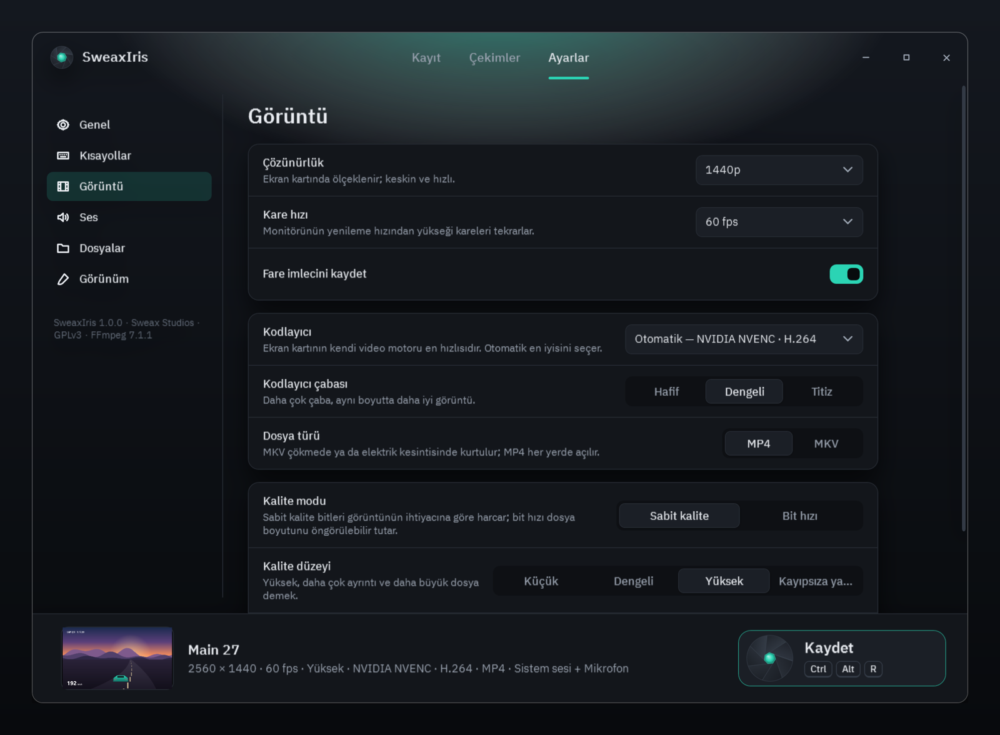</picture><br><sub><b>Görüntü</b> — çözünürlük, kare hızı, kodlayıcı, kalite modu ve düzeyi ya da bit hızı, çaba, anahtar kare, MP4 ya da MKV.</sub></td>
</tr>
<tr>
<td><picture><source media="(prefers-color-scheme: light)" srcset="docs/media/settings-sound-tr-light.png">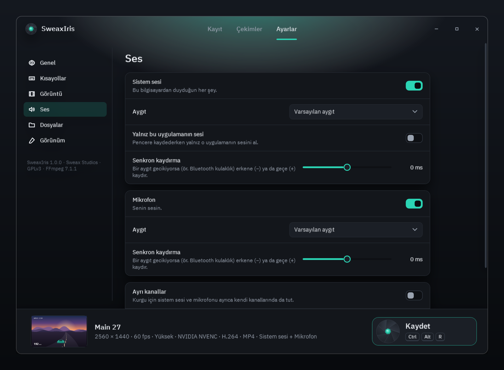</picture><br><sub><b>Ses</b> — aygıtlar, yalnız uygulama sesi, senkron kaydırma, ayrı kanallar, AAC kalitesi.</sub></td>
<td><picture><source media="(prefers-color-scheme: light)" srcset="docs/media/settings-general-tr-light.png">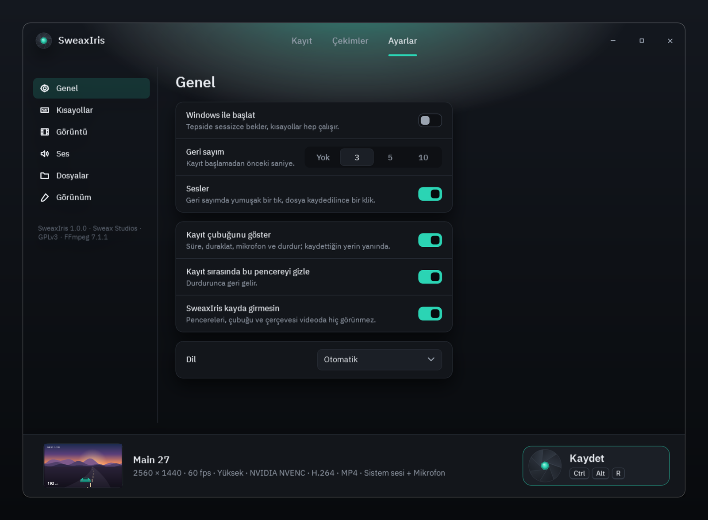</picture><br><sub><b>Genel</b> — Windows ile başlat, geri sayım, kayıt çubuğu, kayıtta gizle, kayda girmesin.</sub></td>
</tr>
</table>

---

## Renkler

Açık, koyu ya da Windows gibi; vurgu için altı lens kaplaması. Kayıt her zaman kırmızıdır.

<p align="center">
  <picture>
    <source media="(prefers-color-scheme: light)" srcset="docs/media/palettes-tr-light.png">
    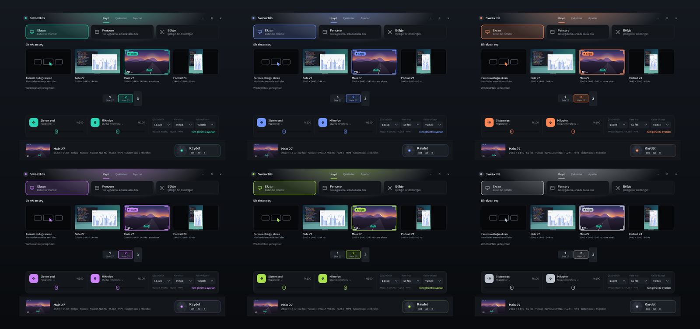
  </picture>
</p>

---

## Kısayollar

| İş | Varsayılan | Not |
|---|---|---|
| Kaydı başlat / durdur | <kbd>Ctrl</kbd> <kbd>Alt</kbd> <kbd>R</kbd> | Geri sayımda basınca vazgeçer. |
| Duraklat / devam | <kbd>Ctrl</kbd> <kbd>Alt</kbd> <kbd>P</kbd> | Aynı dosya, aynı saat. |
| Bölge kaydet | <kbd>Ctrl</kbd> <kbd>Alt</kbd> <kbd>A</kbd> | Seçiciyi açar, çizdiğini kaydeder. |
| Mikrofonu sustur | <kbd>Ctrl</kbd> <kbd>Alt</kbd> <kbd>M</kbd> | Kısa bir geçişle; tık sesi yok. |
| SweaxIris'i göster | atanmadı | |

Beşi de **Ayarlar → Kısayollar**'da birine tıklayıp tuşlara basarak değişir. Kısayollar her yerde, oyunların
içinde de çalışır ve yutulur; oyun onları görmez.

**Makro tuşları (örneğin Monster Pusat K3 Pro'nun G1–G5 tuşları).** Bu tuşlar kutudan çıktığı gibi `F1`–`F5`
gönderir; oyunlar onları kullanır. Birine kimsenin yazmadığı bir tuş ver: K3 Pro'da sırayla `REC`, `G1`, `Pause`,
`REC`'e bas. Sonra Ayarlar'da bir kısayola tıkla ve `G1`'e bas. `Pause`, `Scroll Lock` ve `F13`–`F24` tek başına
kısayol olabilir; harfler ve rakamlar yazmanı engellemesin diye <kbd>Ctrl</kbd> ya da <kbd>Alt</kbd> ister.

Tuşa basmak yerine program çalıştıran başlatıcılar [komut satırını](#komut-satırı) kullanabilir.

---

## Kayıt seçenekleri

| Seçenek | Seçenekler | Varsayılan |
|---|---|---|
| Ne | bir monitör (ya da farenin olduğu), bir pencere, bir bölge | farenin olduğu monitör |
| Çözünürlük | yakalandığı gibi, 2160p, 1440p, 1080p, 720p, 480p (ekran kartında ölçeklenir) | yakalandığı gibi |
| Kare hızı | 24, 30, 48, 50, 60, 90, 120, 144, 165, 240 | 60 |
| Kodlayıcı | Otomatik ya da bu bilgisayarın çalıştırabildiği NVENC / AMF / Quick Sync × H.264 / HEVC / AV1, x264 | Otomatik |
| Kalite | sabit kalite (Küçük, Dengeli, Yüksek, Kayıpsıza yakın) ya da bit hızı (2–150 Mb/s) | Yüksek |
| Kodlayıcı çabası | Hafif, Dengeli, Titiz | Dengeli |
| Anahtar kare aralığı | 1, 2, 3, 5, 10 sn | 2 sn |
| Dosya | MP4 (her yerde açılır) ya da MKV (çökmeden kurtulur) | MP4 |
| Fare imleci | açık / kapalı | açık |
| Geri sayım | yok, 3, 5, 10 sn | 3 sn |

SweaxIris açılırken bu bilgisayarın hangi kodlayıcıları gerçekten çalıştırdığına bakar (her birini bir an açar)
ve yalnız onları sunar. Renk BT.709, TV aralığında; dosyaya yazılır, oynatıcılar gördüğün rengi gösterir.

## Ses

| | Sistem sesi | Mikrofon |
|---|---|---|
| Aç/kapa ve ses düzeyi (%0–200) | ✓ | ✓ |
| Aygıt | varsayılan (Windows değiştirince izler) ya da seçilen | varsayılan ya da seçilen |
| Canlı ölçer | ✓ | ✓ |
| Tuşla sustur | | ✓ |
| Senkron kaydırma (−500…+500 ms) | ✓ | ✓, Bluetooth kulaklık için |
| Yalnız bir uygulamanın sesi | pencere kaydederken | |

İkisi tek bir AAC kanalında karışır (48 kHz, 128–320 kb/s). **Ayrı kanallar** her kaynağı ayrıca kendi
kanalında da tutar, kurgu için. Kayıtta çıkarılan bir aygıt geri takılınca yeniden alınır.

---

## Ölçümler

SweaxIris'in yalnız kendi çizdiğini kaydeden bir öz-testi var (her kareye milisaniye cinsinden zamanını basan
bir GPU test deseni, bir test tonu ve kendi test penceresi); dosyaları `tools/analyze.py` ile geri okur: her
karenin damgası, her flaşa karşı her ton.

Ekran kartı RTX 4070 SUPER, işlemci Ryzen 5 7600 (AMF için içindeki AMD Radeon grafik), Windows 11 25H2:

| Kodlayıcı | Boyut · fps | Kaybolan kare | Ses ile görüntü farkı |
|---|---|---|---|
| NVENC H.264 | 1920×1080 · 60 | 0 | −0,1 ms |
| NVENC H.264 | 2560×1440 · 144 | 0 | −0,2 ms |
| NVENC HEVC | 3840×2160 · 60 | 0 | −0,1 ms |
| NVENC AV1 | 2560×1440 · 120 | 0 | −0,1 ms |
| AMF H.264 (işlemci içi grafik) | 1920×1080 · 60 | 0 | −0,2 ms |
| AMF HEVC (işlemci içi grafik) | 2560×1440 · 60 | 0 | −0,1 ms |
| x264 (işlemci) | 1920×1080 · 60 | 0 | −0,1 ms |

- **Her kare zamanında.** Her kare, zaman damgasının temsil ettiği anı gösterir (ölçülen sapma 1 ms'nin altında);
  yukarıdaki koşuların hiçbirinde kare kaybolmadı ya da tekrarlanmadı.
- **Duraklatma.** Flaş ve ton, her duraklatmadan önce ve sonra birbirinin bir kare yakınında kalır; MP4'te de MKV'de de.
- **Saat kayması.** %0,08 hızlı ya da yavaş çalışan bir ses kartı nazikçe esnetilerek sistem saatine oturtulur;
  iki duraklatmalı 20 saniyelik testin sonunda bile hizalı.
- **Gerçek yakalama.** SweaxIris'in kendi test penceresi Windows.Graphics.Capture ile, kendi sesi yalnız-uygulama
  geri döngüsüyle kaydedildi: ses görüntüden yaklaşık 21 ms sonra geliyor; sabit ve yayın toleransının içinde.
- **Yük altında.** Aynı tablo, üç Blender render'ı işlemciyi %100'de tutarken de koşuldu: NVENC HEVC 4K60 ve AV1
  1440p120 yine hiç kare kaybetmedi; işlemciye bağlı x264 ise kaybetti, beklendiği gibi. SweaxIris kayıtta kendi
  önceliğini yükseltir.

Kendin dene: `SweaxIris.exe --selftest <klasör>`, sonra `python tools/analyze.py <klasör>`.

---

## Nasıl çalışır

<p align="center">
  <picture>
    <source media="(prefers-color-scheme: light)" srcset="docs/art/architecture-light.svg">
    
  </picture>
</p>

- **Yakalama.** Windows.Graphics.Capture monitörün ya da pencerenin her yenilenişini, Windows'un onu çizdiği anla
  birlikte verir. SweaxIris son birkaçını ekran kartında bir halkada tutar.
- **Saat.** Yüksek çözünürlüklü bir zamanlayıcı seçilen kare hızında, gerçek zamanın biraz gerisinden tıklar. Her
  tık kendi anında çizilmiş kareyi alır; oyun düzensizken bile kareler eşit aralıklıdır.
- **Görüntü.** GPU'nun video motoru kareyi ölçekler ve NV12'ye (BT.709) çevirir. NVENC ve AMF için sonuç
  kodlayıcının kendi yüzey havuzuna kopyalanır; ana belleğe hiç uğramaz.
- **Ses.** WASAPI akışları (hoparlörler geri döngüde, mikrofon ya da tek uygulama) yakalandıkları zamanla gelir.
  Mikser her paketi zaman çizelgesine yerleştirir, boşlukları sessizlikle doldurur, ses kartı kaymasını yumuşak
  yeniden örneklemeyle düzeltir, ses değişimlerini yumuşatır ve kanalları toplar.
- **Zaman çizelgesi.** İkisi için tek saat: duraklatınca durur ve bir karenin ya da örneğin nereye gideceğine yalnız
  o karar verir. Duraklatmanın ikinci bir dosya gerektirmemesinin sebebi bu.
- **Dosya.** FFmpeg 7.1, MP4 (Apple oynatıcıları için `hvc1` etiketiyle) ya da MKV yazar.

Kod haritası: `Capture/` (WGC, GPU, dönüşüm, önizleme, canlı kart görüntüleri), `Encode/` (FFmpeg kodlayıcılar ve yazıcı), `Audio/`
(WASAPI, mikser), `Recording/` (zaman çizelgesi, kaydedici, stüdyo), `UI/` (pencereler, diyafram, kontroller,
yaylar), `Dev/` (öz-test, görseller).

---

## Kurulum

1. [Releases](https://github.com/Sweax3169/sweaxiris/releases/latest) sayfasından **SweaxIris-1.1.0-Setup.exe**'yi indir.
2. Çalıştır. Yalnız senin kullanıcın için (yönetici gerekmeden) `%LOCALAPPDATA%\Programs\SweaxIris` klasörüne
   kurulur; kısayollar hep çalışsın diye Windows ile başlayabilir.

Kurulum istemiyor musun? Yanındaki zip her klasörden çalışır. `SHA256SUMS.txt` ikisinin de özetini listeler.

**Gerekenler:** Windows 10 2004 ya da sonrası ve DirectX 11 ekran kartı. Windows 11 sarı yakalama çerçevesini kaldırır;
60 fps üstü yakalama için Windows 11 24H2 ya da sonrası gerekir. Donanım kodlayıcılar güncel sürücü ister.

Program kod imzalı olmadığı için Windows SmartScreen ilk seferde uyarabilir: **Ek bilgi → Yine de çalıştır**.

## Komut satırı

```text
SweaxIris.exe               stüdyoyu aç
SweaxIris.exe --background  tepside başla ("Windows ile başlat" bunu kullanır)
SweaxIris.exe --record      kaydı başlat ya da durdur
SweaxIris.exe --stop        kaydı durdur
SweaxIris.exe --pause       duraklat ya da devam et
SweaxIris.exe --region      bölge çiz ve kaydet
SweaxIris.exe --mic         mikrofonu sustur ya da aç
SweaxIris.exe --quit        gerekiyorsa kaydı durdur ve çık
SweaxIris.exe --selftest K  test desenlerini K klasörüne kaydet (bkz. Ölçümler)
```

İkinci bir açılış komutu çalışan SweaxIris'e iletir ve kapanır.

## Dosyalar nerede

```text
%APPDATA%\SweaxIris\
  settings.json      bütün ayarlar
  takes.json         çekimler listesi
  thumbs\            her çekim için küçük bir resim
  sweaxiris.log      olup bitenler, hata bildirimi için
Videolar\SweaxIris\  kayıtlar (Ayarlar → Dosyalar'dan değişir)
```

## Gizlilik

SweaxIris çevrimdışı çalışır. Hiçbir yere bir şey göndermez; hesap yok, telemetri yok. Yalnız sen başlatınca ve
yalnız seçtiğin şeyi kaydeder. Mikrofon ve sistem sesi, ölçerler için yalnız stüdyo penceresi açıkken ve kayıt
için açılır. Monitörlerinin ve pencerelerinin canlı görüntüleri yalnız Kayıt sayfası ekrandayken çalışır, uygulamanın
dışına çıkmaz ve kayıt sırasında durur.

## SSS

**Bir oyun siyah görünüyor.** Gerçek "özel tam ekran" kipindeki oyunları Windows çizmez; oyunu kenarlıksız ya da tam
ekran iyileştirmeli kipe al (DirectX 11/12 oyunlarının çoğunda varsayılan).

**Bir programda kısayollar çalışmıyor.** O program yönetici olarak çalışıyor; Windows onun tuşlarını normal
programlara vermez. SweaxIris'i de yönetici olarak çalıştır ya da bir başlatıcıdan komut satırını kullan.

**Bölge iki monitöre taşabilir mi?** Hayır; çizmeye başladığın monitörde kalır.

**HDR?** HDR ekranlar, Windows'un yakalama için eşlediği gibi SDR kaydedilir.

**Neden MKV seçeyim?** Elektrik kesintisi ya da çökme, MKV'yi o ana kadar oynatılabilir bırakır; bitmemiş MP4 açılmaz.

**Bluetooth kulaklığımın sesi geç geliyor.** Ayarlar → Ses'te o aygıta eksi bir senkron kaydırma ver.

## Kaynaktan derleme

```powershell
./tools/fetch-ffmpeg.ps1                 # FFmpeg 7.1.1 paylaşımlı kütüphaneleri, SHA-256 ile denetlenir
dotnet build src/SweaxIris -c Release
dotnet publish src/SweaxIris -c Release -r win-x64 --self-contained true -p:PublishSingleFile=true -o out/app
out/app/SweaxIris.exe --selftest out/test ; python tools/analyze.py out/test
```

Görseller: `SweaxIris.exe --shots docs/shots --theme dark --lang tr`, sonra
`python tools/encode-media.py docs/shots docs/media` ve `python tools/art.py docs/art`. Sürümleri GitHub Actions
(`.github/workflows/build.yml`) Inno Setup ile derler.

## Lisans

GPL v3 — bkz. [LICENSE](LICENSE). SweaxIris; FFmpeg 7.1.1 (gyan.dev'in GPL v3 derlemesi), FFmpeg.AutoGen,
Vortice.Windows ve IBM Plex Sans yazı tipini kullanır; bkz. [THIRD_PARTY_NOTICES.md](THIRD_PARTY_NOTICES.md).

**Sweax Studios** yapımı · [github.com/Sweax3169](https://github.com/Sweax3169)
