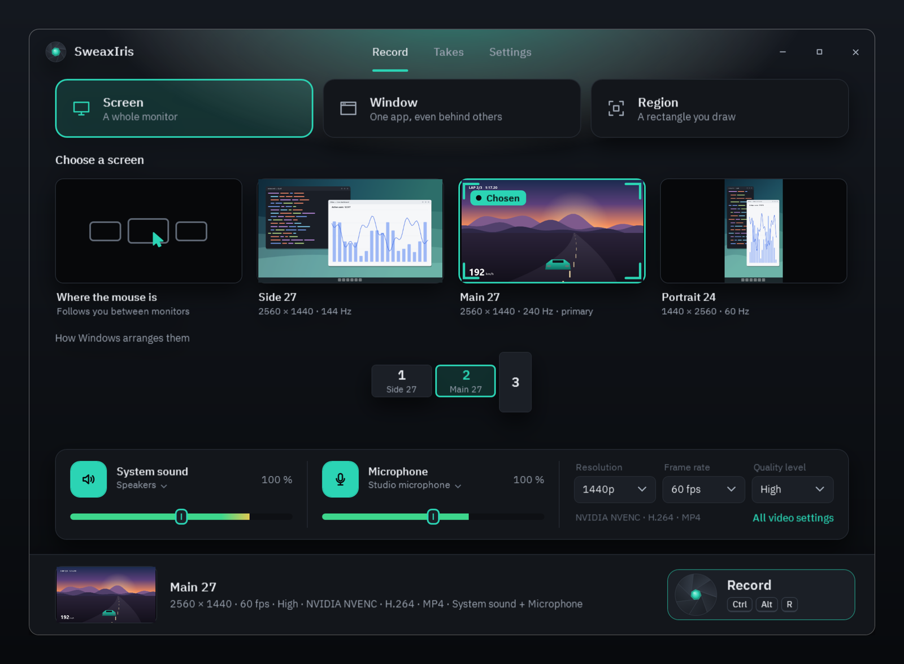
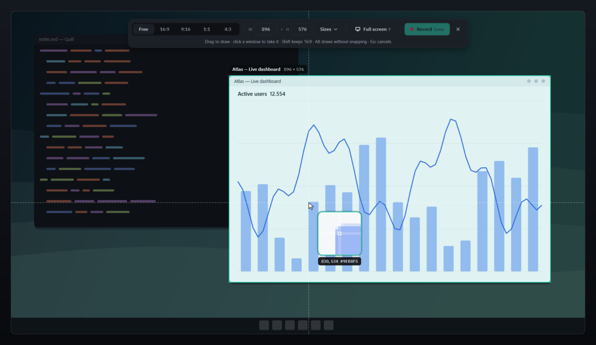

**SweaxIris 1.1.0** — the studio, rebuilt.

### Choosing what to record
- **Live pictures of everything you can record.** Screen shows every monitor (plus *where the mouse is*), Window shows every open window, even ones behind others (search by title or app), Region shows *draw a new region* next to your last one. Click a picture and that is what records.
- With several monitors, a **to-scale map** shows how Windows arranges them; click a monitor there too.
- The **record strip** at the bottom always says what will happen: the chosen picture, its size after scaling, frame rate, quality, encoder and sound, next to the iris and its shortcut.

### Sound and picture
- One **fader** per source that is also its **meter**: the bar shows how loud the source is after the volume, the knob sets the volume (0–200 %, a soft click at 100 %, the mouse wheel works). The device is one click away under the name.
- Resolution, frame rate and quality (or the bitrate) right on the deck; **All video settings** opens the Video page.

### While recording
- The picker gives way to the **program picture**: what is being recorded, large, with `REC` and the time. Pause, mic and stop on the strip.

### Takes and Settings
- **Takes** is a page of its own: cards with picture, length, size and frame rate; click to play, hover to show in the folder or move to the Recycle Bin.
- **Settings** is a page of the studio (Esc goes back). Video now separates *Quality mode* and *Quality level*.

### A new region picker

- A **dock** with frame shapes (Free, 16:9, 9:16, 1:1, 4:3), the **exact size in pixels** (type it), ready-made **sizes** (4K, 1440p, 1080p, 720p, 1080 × 1920, 1080 × 1350, 1080 × 1080), **Full screen**, Record and Cancel.
- The frame **glides** onto the window under the pointer; edges **snap** to windows and screen edges with a guide line (Alt draws freely).
- A **loupe** shows the pixels under the pointer, with position and colour.
- Arrows nudge, Ctrl + arrows resize, F takes the full screen, Enter or a double-click records.

### Unchanged
The recording engine is the same as 1.0.0 (self-test: 0 frames lost, sound within a few milliseconds of the picture, pauses into the same file).

Files: **SweaxIris-1.1.0-Setup.exe** (per-user install, no administrator) and **SweaxIris-1.1.0-win-x64.zip** (portable). Checksums in `SHA256SUMS.txt`.
Built with FFmpeg 7.1.1 (gyan.dev GPL v3 shared build, archive SHA-256 `9f28727e8b472a04c1d2e520aaa425dca82721b995139b35710091130ea6e699`). The program is not code-signed; SmartScreen may ask once (More info → Run anyway).

---

**Türkçe:** 1.1.0'da stüdyo baştan yapıldı: kaydedilebilecek her şey (monitörler, pencereler, son bölge) canlı görüntü olarak tıklanır; ses sürgüleri aynı zamanda ölçer; kayıt şeridi ne olacağını her an söyler; kayıtta büyük yayın görüntüsü; Çekimler ve Ayarlar kendi sayfaları. Bölge seçicide çerçeve oranları, piksel olarak boyut, hazır boyutlar, kenara yapışma ve büyüteç var. Kayıt motoru 1.0.0 ile aynı.
